# Visual identity and design system

The site has its own identity: **beige paper**, **midnight-blue ink** and **worn, hand-drawn lines**, like an old scribbled card game. Everything starts from a few tokens defined once and reused by every component.

The images of this page are in [`docs/design-system/`](design-system/).

← Back to the [README](../README.md)

## Table of contents

1. [Colours](#colours)
2. [Typography](#typography)
3. [Illustrations](#illustrations)
4. [The ten signature components](#the-ten-signature-components)
5. [Other components](#other-components)

---

## Colours

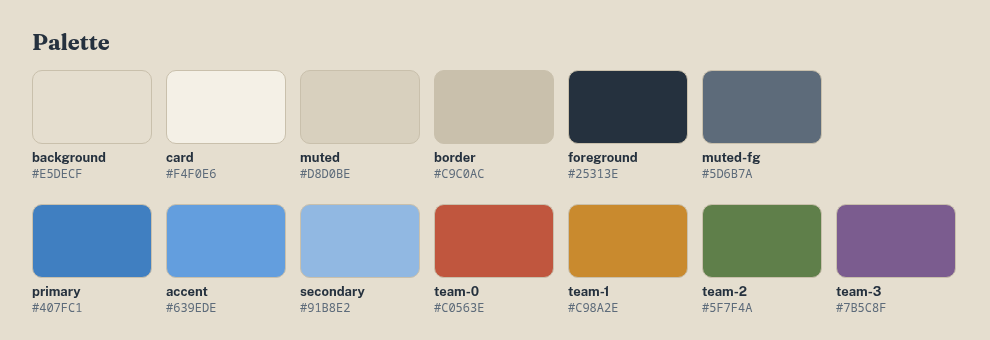

Every colour is a CSS variable in [`frontend/src/styles/globals.css`](../frontend/src/styles/globals.css) (`:root`). Tailwind exposes them as classes (`bg-primary`, `text-muted-foreground`…): no component writes a colour by hand.

| Role | Tokens | Use |
|---|---|---|
| Paper | `--background`, `--card`, `--muted`, `--border` | page background, cards laid on it, borders |
| Ink | `--foreground`, `--muted-foreground` | text, lines, drawings |
| Blues | `--primary`, `--accent`, `--secondary` | buttons, links, focus |
| Teams | `--team-0` to `--team-3` | the four players on the board (pawns, avatars, badges) |

## Typography

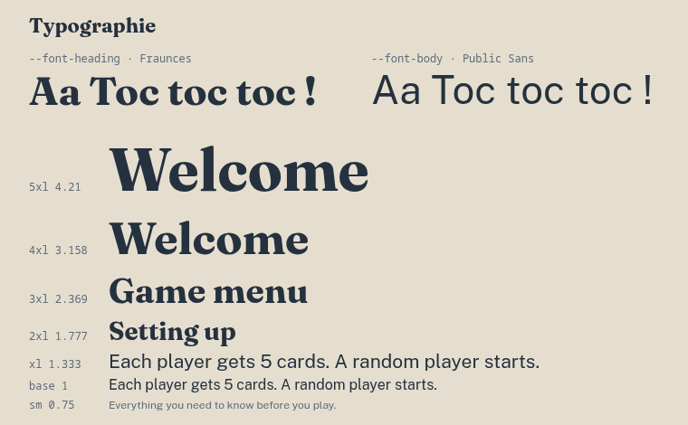

- **Fraunces** (`font-heading`): titles, names, big buttons. A serif with character, which recalls playing cards.
- **Public Sans** (`font-body`): body text and forms. Plain and readable.
- Both are loaded with `next/font` in [`_app.tsx`](../frontend/src/pages/_app.tsx).
- Sizes follow a **modular scale with a 1.333 ratio** (`@theme` in [`globals.css`](../frontend/src/styles/globals.css)), from `text-sm` (0.75 rem) to `text-5xl` (4.21 rem).

## Illustrations

The demons, the cards and the logo ([`frontend/public/`](../frontend/public/)) are drawn by hand and share the same ink style as the rest of the site.

  
  
  
  

Small interface icons come from `lucide-react` and follow the text colour (`currentColor`).

## The ten signature components

These components are written by us and carry the identity of the site. They get their content through their props and depend on no page: they can be used anywhere.

### 1. The logo

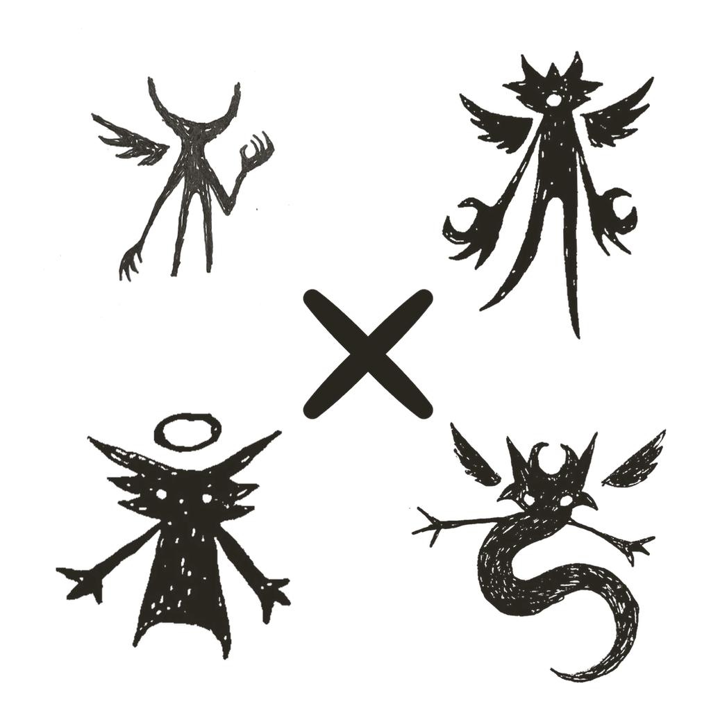

Drawn by hand, then used as a **CSS mask** (`.logo-mask` in [`globals.css`](../frontend/src/styles/globals.css)): the drawing is painted with `currentColor`, so it always takes the ink colour of the page and reacts to hover like text. It sits in the [`Header`](../frontend/src/components/layout/Header.tsx) and links to the menu.

### 2. [`PageLayout`](../frontend/src/components/layout/PageLayout.tsx)

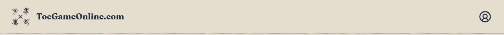

The shell shared by every page: the paper background (`paperStyle`), the [`Header`](../frontend/src/components/layout/Header.tsx) with the logo, the centred content and the [`Footer`](../frontend/src/components/layout/Footer.tsx) with the Privacy Policy and Terms of Service links. Header and footer are separated from the content by a worn line. A page only has to write `<PageLayout>…</PageLayout>` to look like the rest of the site.

### 3. [`WornFrame`](../frontend/src/components/layout/WornFrame.tsx), the worn card

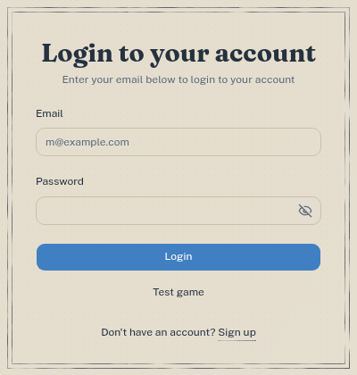

The "card" of the site: a double frame drawn in worn lines, each line worn in different places. Used for login, sign-up, every section of the rules, the profile, the join page, the Privacy Policy and the Terms of Service.

### 4. The worn lines

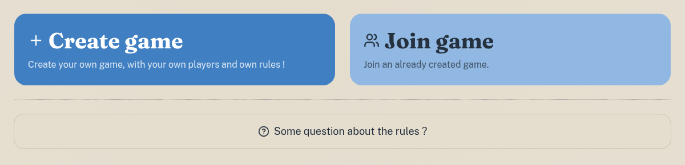

The visual signature of the site. Every line (frames, separators, underlines, header, footer) uses two custom CSS utilities from [`globals.css`](../frontend/src/styles/globals.css):

- **`worn-line`**: an SVG noise (`feTurbulence`) is used as a mask and erases the line in places, like worn ink.
- **`worn-underline`**: the same for link underlines, without damaging the text.

[Buttons](../frontend/src/components/ui/button.tsx) and the [separator](../frontend/src/components/ui/separator.tsx) start from shadcn/ui but are restyled with our tokens and typography; the separator and the `link` button variant use the worn line.

### 5. The hand-drawn circles

Round shapes are never perfect circles. [`lib/game/handDrawn.ts`](../frontend/src/lib/game/handDrawn.ts) builds SVG paths that look drawn with a pen:

- `handDrawnCirclePath(cx, cy, r, seed)`: a slightly shaky circle (the board cells, the pawns, the badges, the avatars of the players, the destination markers);
- `handDrawnLinePath(points, seed)`: a shaky line (the trail of a moving pawn).

The shake depends on a fixed **seed**, so a drawing never changes from one render to the next, and the numbers are rounded so the server and the browser draw exactly the same path.

### 6. [`DemonCircle`](../frontend/src/components/demons/DemonCircle.tsx)

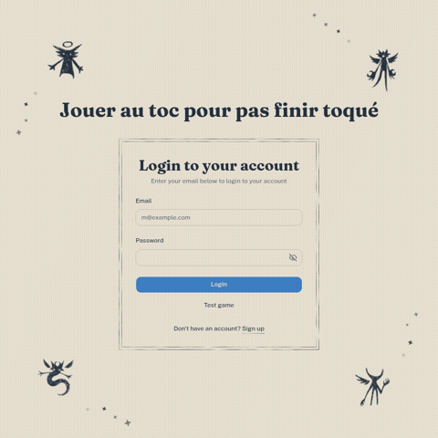

| Props | Role |
|---|---|
| `children`, `variant` | a ring of demons turning around (or over) any content, each one leaving a [`SparkleTrail`](../frontend/src/components/demons/SparkleTrail.tsx) behind it |

Used around the login and sign-up forms, and over the profile card on the profile pages (`variant="over"`).

### 7. [`DemonCampfire`](../frontend/src/components/demons/DemonCampfire.tsx)

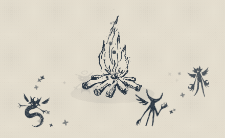

The four demons dancing around the fire, on the main menu. The fire itself ([`CracklingFire`](../frontend/src/components/demons/CracklingFire.tsx)) is made entirely in code, with no image.

### 8. The cards: `TiltCard` and `CardRule`

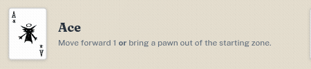

| Component | Props | Role |
|---|---|---|
| [`TiltCard`](../frontend/src/components/rules/TiltCard.tsx) | `imagePath`, `label` | a card that tilts towards the pointer and grows on hover (`motion` spring) |
| [`CardRule`](../frontend/src/components/rules/CardRule.tsx) | `name`, `imagePath`, `children` | a `TiltCard` with its name and explanation |

  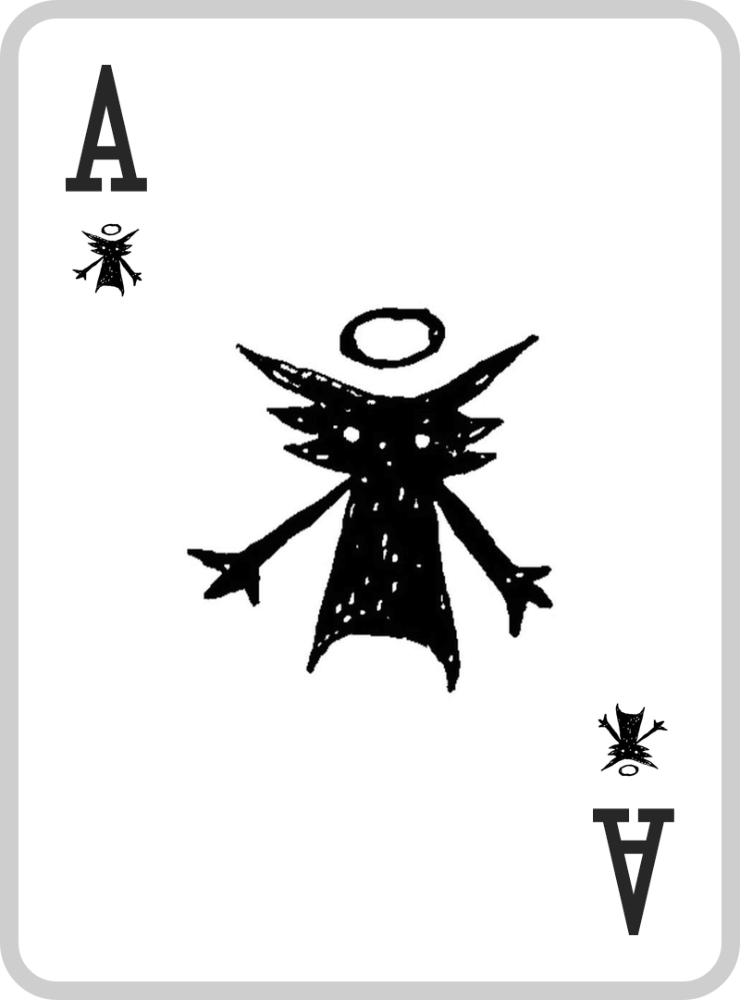
  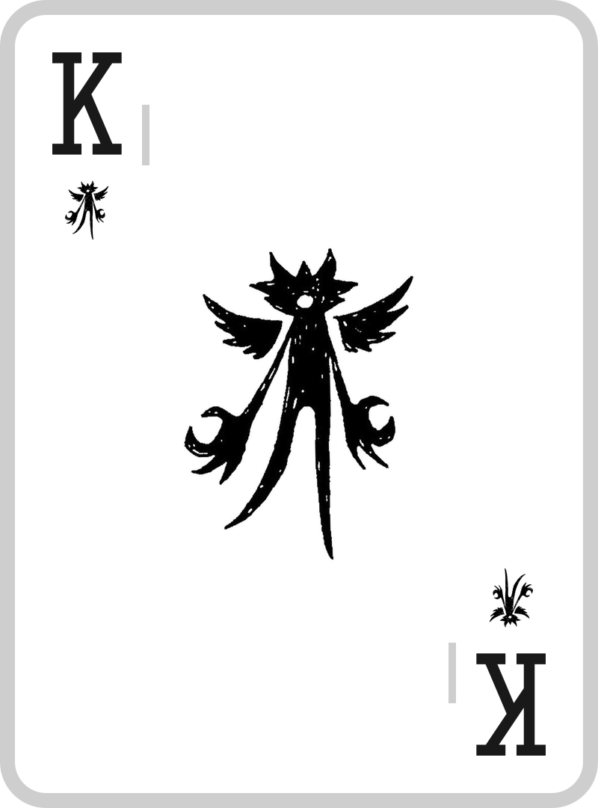
  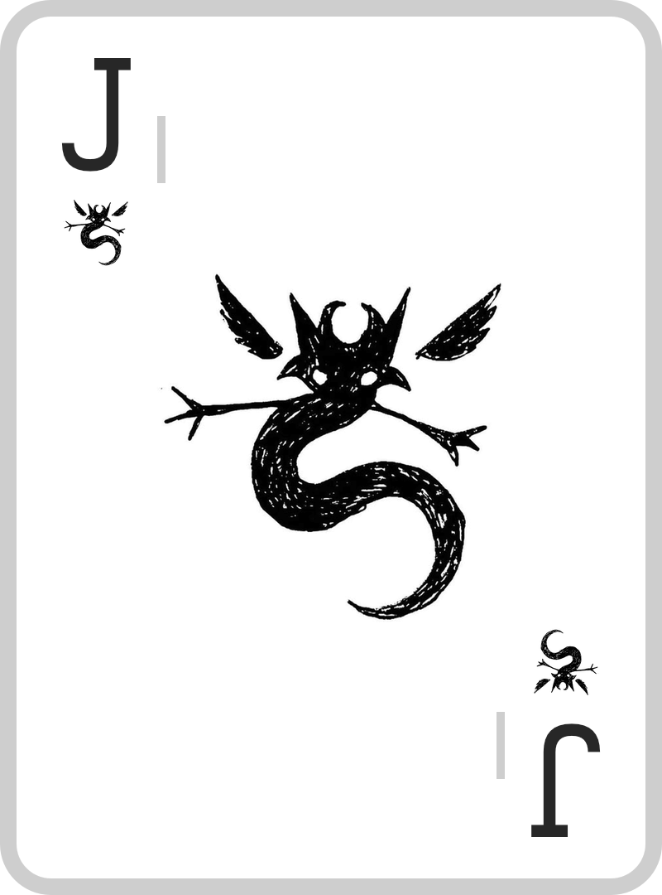

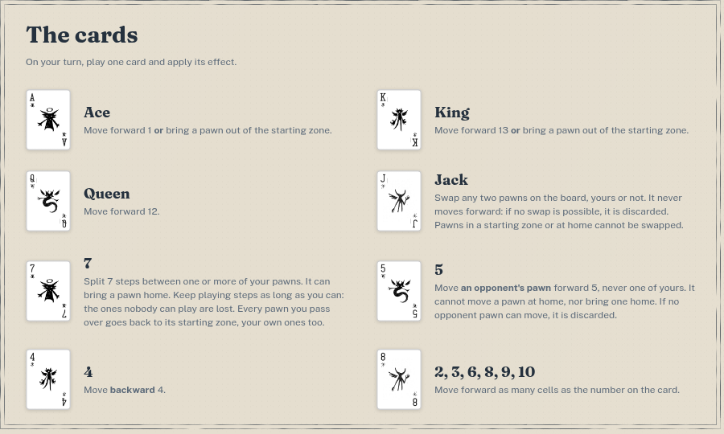

### 9. [`Pawn`](../frontend/src/components/game/Pawn.tsx)

| Props | Role |
|---|---|
| `color`, `position`, `path`, `isSelectable`, `onClick`… | a hand-drawn pawn in its team colour that hops cell by cell along `path` (it swells, leans and squashes when it lands), bursts when it is captured and pops back in its spawn |

### 10. [`SeatBadge`](../frontend/src/components/game/SeatBadge.tsx)

| Props | Role |
|---|---|
| `seat`, `isTaken`, `className` | a seat's demon in a shaky circle in the team colour; greyed and dotted when the seat is free. Used in the waiting room, in the turn controls and on the win screen. |

## Other components

| Component | Props | Role |
|---|---|---|
| [`Board`](../frontend/src/components/game/Board.tsx) | `boardSize`, `bottomSeat`, `children` | the hand-drawn board, turned so that each player sees their own seat at the bottom; pawns are drawn inside it |
| [`TurnBanner`](../frontend/src/components/game/TurnBanner.tsx) | `isMyTurn`, `mySeat` | "Your turn!" written for a moment across the board |
| [`WinScreen`](../frontend/src/components/game/WinScreen.tsx) | `winnerSeat`, `winnerName`, `isMe` | the win screen with confetti |
| [`AngerMarks`](../frontend/src/components/demons/AngerMarks.tsx) | `isVisible` | small anger marks above a character |
| [`CracklingFire`](../frontend/src/components/demons/CracklingFire.tsx) | — | the animated fire of the campfire, made in code |
| [`SparkleTrail`](../frontend/src/components/demons/SparkleTrail.tsx) | `getSpots` | a trail of sparkles behind what moves (the demons of the ring) |
| [`DemonDrawing`](../frontend/src/components/demons/DemonDrawing.tsx) | `image` | any demon drawing, inked with the palette |
| [`Title` / `Subtitle`](../frontend/src/components/layout/Title.tsx) | `children` | page titles, on the type scale |
| [`PasswordInput`](../frontend/src/components/auth/PasswordInput.tsx) | the props of an `input` | a password field with a show / hide button |
